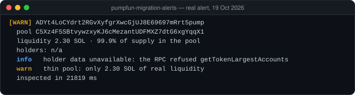

# pumpfun-migration-alerts

[](LICENSE)    

Real-time alerts when a pump.fun token graduates to a PumpSwap pool, with on-chain risk flags.
Read-only: no wallet, no keys, no trading. Runs on free RPC.

<p align="center"></p>

## What it does

1. Listens to PumpPortal's migration stream over a single WebSocket.
2. Derives the token's canonical PumpSwap pool from the mint address — no searching, no guessing.
3. Reads the pool, the mint and both pool vaults: the SOL really in the pool and the share of the supply it holds.
4. Measures how much of the supply sits in the largest accounts outside the pool.
5. Prints an alert, optionally sends it to Telegram and appends it to a JSONL file.

Three RPC calls per migration.

## Sample output

A real token from 19 Oct 2026, inspected on the public RPC:

```
[WARN] ADYt4LoCYdrt2RGvXyfgrXwcGjUJ8E69697mRrt5pump
  pool C5Xz4F5SBtvywzxyKJ6cMezantUDFMXZ7dtG6xgYqqX1
  liquidity 2.30 SOL · 99.9% of supply in the pool
  holders: n/a
  info   holder data unavailable: the RPC refused getTokenLargestAccounts
  warn   thin pool: only 2.30 SOL of real liquidity
  inspected in 21819 ms
```

The public endpoint refuses `getTokenLargestAccounts`, so the holder line is empty and the inspection waited out
three retries. With a free-tier key from an RPC provider the holder line is filled and an inspection takes about a second.

## Risk flags

| Flag | Level | Why it matters |
|---|---|---|
| One account holds ≥ `TOP_HOLDER_DANGER_PCT` (50%) of supply | danger | One seller can empty the pool |
| One account holds ≥ `TOP_HOLDER_WARN_PCT` (25%) of supply | warn | Concentrated supply, a different kind of launch |
| Real SOL in the pool below `THIN_POOL_SOL` (5) | warn | A seller can only take out the SOL that is really in the pool |
| Mayhem-mode pool | warn | In our measurements these pools held almost no liquidity |
| Cashback enabled | info | A pool feature flag |

## Engineering notes

- **Canonical pool by PDA.** `authority = PDA(["pool-authority", mint], pump)`,
  `pool = PDA(["pool", u16 0, authority, mint, WSOL], PumpSwap)`. The formula was checked against 300 live pools.
- **Forward-compatible decoding.** pump.fun appends new fields to the end of the pool account, so the decoder checks
  for a minimum length and the discriminator instead of an exact size.
- **One socket, careful reconnects.** Exponential backoff with ±20% jitter that resets only after 60 s of stable
  connection, plus a watchdog for sockets that stay open but deliver nothing. A client that reconnects in a tight loop
  can get its address refused by the feed for hours.
- **RPC discipline.** Calls are serialized under `RPC_MAX_RPS`; 429s, 5xx and network errors are retried after 2, 5 and
  12 s; API keys and bot tokens are masked in every log line.
- **The node may not see the pool yet.** The pool account is re-read up to 10 times, one second apart; an account that
  can never become a pool fails at once.
- **Partial data beats no data.** If holder data is refused, the alert still goes out and says what is missing.

## Quick start

Requires Node.js 22.9 or newer.

```bash
npm install
cp .env.example .env
```

```bash
npm start
```

```bash
npm run replay -- <mint address>
```

```bash
npm test
```

`npm start` watches live migrations, `npm run replay` inspects one token, `npm test` runs 21 tests (decoding, PDA
derivation, risk flags, retries, rate limiting, secret masking). All settings are in `.env.example`.

### Telegram alerts

1. Create a bot with [@BotFather](https://t.me/BotFather) and copy its token.
2. Send any message to the bot, open `https://api.telegram.org/bot<TOKEN>/getUpdates` and copy `chat.id`.
3. Put `TELEGRAM_BOT_TOKEN` and `TELEGRAM_CHAT_ID` into `.env`.

## Limitations

- Holder concentration counts token accounts, not owners, so it is a lower bound.
- Public RPC endpoints often refuse `getTokenLargestAccounts`; a free-tier provider key fixes that.
- Alerts are information, not trading advice.

## По-русски

Бот следит за переходом монет pump.fun в пулы PumpSwap и сразу проверяет каждую монету по данным блокчейна:
реальную ликвидность пула, долю крупнейших держателей, особые режимы пула. Отчёт выводится в консоль, по желанию
отправляется в Telegram и пишется в файл JSONL. Только чтение: без кошелька, ключей и торговли.

Запуск: `npm install`, затем `npm start` — следить за миграциями, или `npm run replay -- <адрес монеты>` — проверить одну
монету. Настройки — в `.env.example`.

## Author

Artem Vartanov · [t.me/artemvartanov](https://t.me/artemvartanov). Built with AI assistance (Claude Code). MIT licence.
